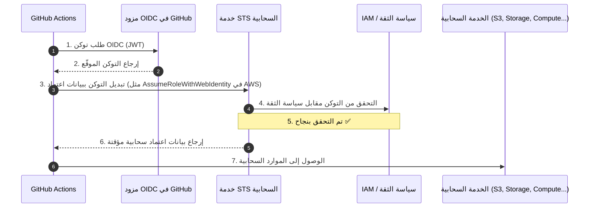

🌐 [English](14-oidc.md) · **العربية**

# 14 — OIDC: دخول سحابي بلا مفاتيح

> الملف: [`14-oidc.yml`](../.github/workflows/14-oidc.yml)

**الهدف:** استبدال مفاتيح السحابة الطويلة الأمد (مثل مفتاح Service Account بصيغة JSON) بهوية قصيرة العمر. يستخدم الدرس Google Cloud وFirebase كمثال تطبيقي، لكن **OIDC معيار مفتوح تدعمه مزودات كثيرة** (انظر [ليس لـ Google فقط](#ليس-لـ-google-فقط)).

## قبل / بعد

|           | مفتاح JSON (المرحلة 10) | OIDC (هذه المرحلة)            |
| --------- | ----------------------- | ----------------------------- |
| في GitHub | سر لا ينتهي             | **لا شيء**                    |
| العمر     | حتى تدوّره              | دقائق لكل تشغيل               |
| لو تسرّب  | وصول كامل               | بلا فائدة خارج نافذته         |
| النطاق    | من يملك المفتاح         | هذا المستودع/الفرع/البيئة فقط |

## كيف يعمل

```
 job (id-token: write) ──► مزوّد OIDC عند GitHub ──► JWT موقّع
        │                                                │
        └────────► Google STS (Workload Identity Federation) ◄─┘
                         │ يتحقق من المُصدِر والـ claims
                         ▼
                 توكن وصول قصير العمر (بهوية الـ service account)
```



## ليس لـ Google فقط

الفكرة واحدة عند الجميع: GitHub يصدر JWT موقّعاً، والمزود يتحقق منه مقابل **سياسة ثقة** تحددها أنت، ثم يعطي اعتماداً مؤقتاً. الذي يختلف هو اسم الميزة، ومكان شرط الثقة، والـ action المستخدم.

| المزود              | الآلية                                          | الـ Action الرسمي                            | أين يوضع شرط الثقة                        |
| ------------------- | ----------------------------------------------- | -------------------------------------------- | ----------------------------------------- |
| **Google Cloud**    | Workload Identity Federation                    | `google-github-actions/auth`                 | `attribute-condition` على الـ provider    |
| **AWS**             | IAM OIDC provider + `AssumeRoleWithWebIdentity` | `aws-actions/configure-aws-credentials`      | `Condition` في سياسة الثقة للـ Role       |
| **Azure**           | Federated credentials على App Registration      | `azure/login`                                | الـ `subject` في الـ federated credential |
| **HashiCorp Vault** | JWT/OIDC auth method                            | `hashicorp/vault-action`                     | `bound_claims` في الـ role                |
| **Alibaba Cloud**   | OIDC role SSO                                   | `aliyun/configure-aliyun-credentials-action` | شرط الثقة في RAM role                     |

منصات أخرى (مثل Kubernetes وTerraform Cloud وغيرها) تدعمه أيضاً بإعداد خاص بكل منها. **كيف تتحقق من مزود معيّن:** ابحث في توثيقه عن _"GitHub Actions OIDC"_ أو _"workload identity federation"_ أو _"federated credentials"_. كما يشرح GitHub المفهوم العام في _Security hardening with OpenID Connect_.

### مثال AWS (للمقارنة)

```yaml
permissions:
  id-token: write
  contents: read
steps:
  - uses: aws-actions/configure-aws-credentials@v4
    with:
      role-to-assume: arn:aws:iam::123456789012:role/gh-deployer
      aws-region: us-east-1
```

شرط سياسة الثقة (الجزء الأهم):

```json
"Condition": {
  "StringEquals": {
    "token.actions.githubusercontent.com:aud": "sts.amazonaws.com",
    "token.actions.githubusercontent.com:sub": "repo:OWNER/REPO:ref:refs/heads/main"
  }
}
```

### مثال Azure

```yaml
permissions:
  id-token: write
  contents: read
steps:
  - uses: azure/login@v2
    with:
      client-id: ${{ vars.AZURE_CLIENT_ID }}
      tenant-id: ${{ vars.AZURE_TENANT_ID }}
      subscription-id: ${{ vars.AZURE_SUBSCRIPTION_ID }}
```

القاعدة نفسها كما في Google: **قيّد دائماً بالمستودع (والأفضل بالفرع أو الـ environment)**، وإلا استطاع أي مستودع استخدام الـ role.

## الـ claims في التوكن

الـ claims تصف التشغيل: `iss` و`aud` و`sub` و`repository` و`ref` و`workflow` و`environment` و`job_workflow_ref` و`actor`. الـ job الأول في الـ workflow يطبعها.

### `aud` (الجمهور)

الجهة المقصودة بالتوكن. كل مزود يتوقع قيمة محددة (AWS: `sts.amazonaws.com`، وaction الخاص بـ Google يضبطها تلقائياً). في job الفحص استخدمنا `github-actions-demo` وهي قيمة تجريبية فقط.

### `sub` (الموضوع) يتغير حسب السياق

هو أساس التقييد الدقيق، وأكثر مصدر لأخطاء "Permission denied".

| سياق التشغيل           | قيمة `sub`                               |
| ---------------------- | ---------------------------------------- |
| فرع                    | `repo:OWNER/REPO:ref:refs/heads/main`    |
| وسم (tag)              | `repo:OWNER/REPO:ref:refs/tags/v1.0.0`   |
| Pull request           | `repo:OWNER/REPO:pull_request`           |
| job يستخدم environment | `repo:OWNER/REPO:environment:production` |

> إذا استخدم الـ job الخاصية `environment:` تصبح قيمة `sub` بصيغة **الـ environment** وليس الفرع. فتُرفض إن كانت سياسة الثقة مكتوبة لـ `ref:refs/heads/main`.

### `job_workflow_ref` والـ Reusable workflows

عند استخدام OIDC داخل reusable workflow، تحدد claims مثل `job_workflow_ref` **أي ملف workflow** يعمل. التقييد بها يحصر الوصول في "هذا الـ workflow تحديداً" وليس فقط "هذا المستودع".

## جانب الـ workflow

```yaml
permissions:
  contents: read
  id-token: write # إلزامي
steps:
  - uses: actions/checkout@v7 # قبل auth
  - uses: google-github-actions/auth@v3 # هو من يكتب ملف الاعتماد ويدير حذفه
    with:
      workload_identity_provider: ${{ vars.GCP_WORKLOAD_IDENTITY_PROVIDER }}
      service_account: ${{ vars.GCP_SERVICE_ACCOUNT }}
  - uses: ./.github/actions/deploy-firebase-hosting # بلا service-account
    with:
      project-id: ${{ vars.FIREBASE_PROJECT_ID }}
```

القيمتان **متغيرات** (vars) لا أسرار: فهما غير حساستين.

## إعداد Google Cloud (مرة واحدة)

```bash
gcloud iam workload-identity-pools create github-pool --location=global

gcloud iam workload-identity-pools providers create-oidc github-provider \
  --location=global --workload-identity-pool=github-pool \
  --issuer-uri="https://token.actions.githubusercontent.com" \
  --attribute-mapping="google.subject=assertion.sub,attribute.repository=assertion.repository" \
  --attribute-condition="assertion.repository == 'AbdullahNamespace/learn-github-actions-by-practice'"

gcloud iam service-accounts add-iam-policy-binding SA_EMAIL \
  --role=roles/iam.workloadIdentityUser \
  --member="principalSet://iam.googleapis.com/projects/PROJECT_NUMBER/locations/global/workloadIdentityPools/github-pool/attribute.repository/AbdullahNamespace/learn-github-actions-by-practice"
```

ثم امنح الـ service account دور **Firebase Hosting Admin**. الشرط `attribute-condition` هو ما يمنع مستودعات أخرى من استخدام الـ pool. لا تتجاوزه أبداً.

## التحصين

- قيّد بـ `repository`، وللإنتاج قيّد أيضاً بـ `ref` أو `environment`.
- امنح الـ service account أقل دور ممكن.
- احذف مفتاح JSON القديم وسر `FIREBASE_SERVICE_ACCOUNT` بعد نجاح OIDC.

### التقييد بالـ environment (يرتبط بـ [المرحلة 13](13-environments.ar.md))

اربط الـ claim الخاص بالـ environment ثم اشترطه:

```bash
gcloud iam workload-identity-pools providers update-oidc github-provider \
  --location=global --workload-identity-pool=github-pool \
  --attribute-mapping="google.subject=assertion.sub,attribute.repository=assertion.repository,attribute.environment=assertion.environment" \
  --attribute-condition="assertion.repository == 'OWNER/REPO' && assertion.environment == 'production'"
```

الآن لا يستطيع الدخول إلا الـ jobs التي تعمل بـ `environment: production`، والـ environment نفسه يمكن أن يتطلب موافقة يدوية أو يحدد الفروع المسموح لها بالنشر.

### التقييد بـ workflow محدد (Reusable workflows)

اربط `attribute.job_workflow_ref=assertion.job_workflow_ref` وأضفه إلى الشرط لتسمح بملف workflow معروف فقط.

## تأكد أنه يعمل

بعد خطوة `auth` مباشرة تحقق من الهوية المستخدمة:

```yaml
- uses: google-github-actions/setup-gcloud@v2
- run: gcloud auth list
```

يجب أن ترى الـ service account كحساب نشط.

## حل المشاكل

| الخطأ / العرض                                                  | السبب المحتمل                                                                 |
| -------------------------------------------------------------- | ----------------------------------------------------------------------------- |
| `Unable to get ACTIONS_ID_TOKEN_REQUEST_URL`                   | غياب `id-token: write` ([الخطأ 20](mistakes-log.ar.md))                       |
| رفض بسبب attribute condition / `unauthorized_client`           | خطأ في اسم المستودع (حساس لحالة الأحرف)، أو الشرط لا يطابق claims هذا التشغيل |
| `Permission 'iam.serviceAccounts.getAccessToken' denied`       | غياب ربط `roles/iam.workloadIdentityUser` أو `principalSet` خاطئ              |
| Audience does not match                                        | المزود يتوقع `aud` مختلفاً عن الموجود في التوكن                               |
| يعمل على `main` ويفشل مع environment                           | تغيّرت `sub` إلى صيغة `environment:` (انظر الجدول أعلاه)                      |
| AWS: `Not authorized to perform sts:AssumeRoleWithWebIdentity` | `sub`/`aud` في سياسة الثقة لا يطابقان التوكن                                  |

## فخاخ شائعة

- `checkout` بعد `auth` قد يمسح ملف الاعتماد المولّد.
- استخدام **معرّف** المشروع حيث يلزم **رقم** المشروع في المزوّد.
- PRs القادمة من forks لا تحصل على توكن OIDC.
- في `inspect-token` طباعة الـ **payload** آمنة (موقّع وليس سراً). لكن **لا تطبع التوكن الكامل أبداً**: فهو صالح للاستخدام حتى انتهاء صلاحيته. لهذا يخفيه الـ workflow بـ `::add-mask::`.

## تمرين

شغّل الـ workflow: اقرأ الـ claims في الـ job الأول. ثم جهّز WIF وأضف المتغيرات الثلاثة وأعد التشغيل للنشر بلا أي سر. إضافي: أضف تقييد الـ `environment` ولاحظ كيف تتغير `sub`.

> **OIDC معيار وليس ميزة خاصة بـ Google.** تعلّمه مرة واحدة (توكن موقّع ← تحقق من الـ claims ← اعتماد مؤقت) وطبّقه على أي مزود بتغيير الـ action وسياسة الثقة فقط.

⬅️ [13 — Environments](13-environments.ar.md) · ➡️ [15 — Release · Docker · GHCR](15-release-custom-actions.ar.md)
