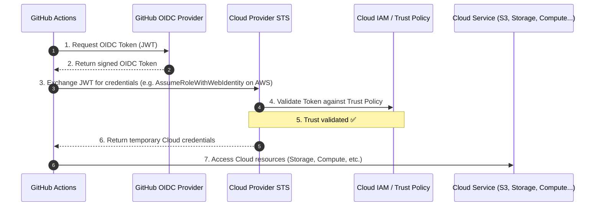

🌐 **English** · [العربية](14-oidc.ar.md)

# 14 — OIDC: Keyless Cloud Login

> Workflow: [`14-oidc.yml`](../.github/workflows/14-oidc.yml)

**Goal:** replace long-lived cloud keys (like a Service Account JSON) with a short-lived identity. The lesson uses Google Cloud + Firebase as the hands-on example, but **OIDC is an open standard supported by many providers** (see [Not just Google](#not-just-google)).

## Before / After

|                  | JSON key (stage 10)         | OIDC (this stage)                 |
| ---------------- | --------------------------- | --------------------------------- |
| Stored in GitHub | a secret that never expires | **nothing**                       |
| Lifetime         | until you rotate it         | minutes, per run                  |
| If leaked        | full access                 | useless outside its window        |
| Scope            | whoever has the key         | only this repo/branch/environment |

## How it works

```
 job (id-token: write) ──► GitHub OIDC provider ──► signed JWT
        │                                              │
        └────────► Google STS (Workload Identity Federation) ◄─┘
                         │ verifies issuer + claims
                         ▼
                 short-lived access token (as the service account)
```



## Not just Google

The idea is identical everywhere: GitHub issues a signed JWT, the provider verifies it against a **trust policy** you define, and returns temporary credentials. What changes is the feature name, where the trust condition lives, and which action you use.

| Provider            | Mechanism                                       | Official action                              | Where the trust condition goes            |
| ------------------- | ----------------------------------------------- | -------------------------------------------- | ----------------------------------------- |
| **Google Cloud**    | Workload Identity Federation                    | `google-github-actions/auth`                 | `attribute-condition` on the provider     |
| **AWS**             | IAM OIDC provider + `AssumeRoleWithWebIdentity` | `aws-actions/configure-aws-credentials`      | `Condition` in the role's trust policy    |
| **Azure**           | Federated credentials on an App Registration    | `azure/login`                                | the `subject` of the federated credential |
| **HashiCorp Vault** | JWT/OIDC auth method                            | `hashicorp/vault-action`                     | `bound_claims` on the Vault role          |
| **Alibaba Cloud**   | OIDC role SSO                                   | `aliyun/configure-aliyun-credentials-action` | trust condition on the RAM role           |

Other platforms (Kubernetes clusters, Terraform Cloud, and more) support it too, with their own setup. **How to check a provider:** search its docs for _"GitHub Actions OIDC"_, _"workload identity federation"_ or _"federated credentials"_. GitHub also documents the general concept in _Security hardening with OpenID Connect_.

### AWS example (for comparison)

```yaml
permissions:
  id-token: write
  contents: read
steps:
  - uses: aws-actions/configure-aws-credentials@v4
    with:
      role-to-assume: arn:aws:iam::123456789012:role/gh-deployer
      aws-region: us-east-1
```

Trust policy condition (the part that matters most):

```json
"Condition": {
  "StringEquals": {
    "token.actions.githubusercontent.com:aud": "sts.amazonaws.com",
    "token.actions.githubusercontent.com:sub": "repo:OWNER/REPO:ref:refs/heads/main"
  }
}
```

### Azure example

```yaml
permissions:
  id-token: write
  contents: read
steps:
  - uses: azure/login@v2
    with:
      client-id: ${{ vars.AZURE_CLIENT_ID }}
      tenant-id: ${{ vars.AZURE_TENANT_ID }}
      subscription-id: ${{ vars.AZURE_SUBSCRIPTION_ID }}
```

The rule is the same as on Google: **always restrict by repository (better: by branch or environment)**, otherwise any repo could use your role.

## The token claims

The JWT claims describe the run: `iss`, `aud`, `sub`, `repository`, `ref`, `workflow`, `environment`, `job_workflow_ref`, `actor`. Job 1 of the workflow prints them.

### `aud` (audience)

Who the token is meant for. Each provider expects a specific value (AWS: `sts.amazonaws.com`; the Google action sets it automatically). In the inspect job we use `github-actions-demo`, which is just a demo value.

### `sub` (subject) changes with the context

This is the basis of precise restriction, and the most common source of "Permission denied" errors.

| Run context              | `sub` value                              |
| ------------------------ | ---------------------------------------- |
| Branch                   | `repo:OWNER/REPO:ref:refs/heads/main`    |
| Tag                      | `repo:OWNER/REPO:ref:refs/tags/v1.0.0`   |
| Pull request             | `repo:OWNER/REPO:pull_request`           |
| Job using an environment | `repo:OWNER/REPO:environment:production` |

> If a job uses `environment:`, its `sub` becomes the **environment** form, not the branch form. A trust policy written for `ref:refs/heads/main` will then reject it.

### `job_workflow_ref` and reusable workflows

When OIDC is used inside a reusable workflow, claims like `job_workflow_ref` identify **which workflow file** is running. Restricting on it limits access to "this specific workflow", not just "this repo".

## Workflow side

```yaml
permissions:
  contents: read
  id-token: write # required
steps:
  - uses: actions/checkout@v7 # before auth
  - uses: google-github-actions/auth@v3 # writes the credentials file and manages its cleanup
    with:
      workload_identity_provider: ${{ vars.GCP_WORKLOAD_IDENTITY_PROVIDER }}
      service_account: ${{ vars.GCP_SERVICE_ACCOUNT }}
  - uses: ./.github/actions/deploy-firebase-hosting # no service-account input
    with:
      project-id: ${{ vars.FIREBASE_PROJECT_ID }}
```

Both values are **variables**, not secrets: they aren't sensitive.

## Google Cloud setup (once)

```bash
gcloud iam workload-identity-pools create github-pool --location=global

gcloud iam workload-identity-pools providers create-oidc github-provider \
  --location=global --workload-identity-pool=github-pool \
  --issuer-uri="https://token.actions.githubusercontent.com" \
  --attribute-mapping="google.subject=assertion.sub,attribute.repository=assertion.repository" \
  --attribute-condition="assertion.repository == 'AbdullahNamespace/learn-github-actions-by-practice'"

gcloud iam service-accounts add-iam-policy-binding SA_EMAIL \
  --role=roles/iam.workloadIdentityUser \
  --member="principalSet://iam.googleapis.com/projects/PROJECT_NUMBER/locations/global/workloadIdentityPools/github-pool/attribute.repository/AbdullahNamespace/learn-github-actions-by-practice"
```

Then grant the service account **Firebase Hosting Admin**. The `attribute-condition` is what stops other repositories from using your pool. Never skip it.

## Hardening

- Restrict by `repository`, and further by `ref` or `environment` for production.
- Give the service account the minimum role.
- Delete the old JSON key and the `FIREBASE_SERVICE_ACCOUNT` secret once OIDC works.

### Restrict to an environment (ties in with [stage 13](13-environments.md))

Map the `environment` claim, then require it in the condition:

```bash
gcloud iam workload-identity-pools providers update-oidc github-provider \
  --location=global --workload-identity-pool=github-pool \
  --attribute-mapping="google.subject=assertion.sub,attribute.repository=assertion.repository,attribute.environment=assertion.environment" \
  --attribute-condition="assertion.repository == 'OWNER/REPO' && assertion.environment == 'production'"
```

Now only jobs running with `environment: production` can authenticate, and that environment can itself require manual approval or limit which branches may deploy.

### Pin to a specific workflow (reusable workflows)

Map `attribute.job_workflow_ref=assertion.job_workflow_ref` and add it to the condition to allow only a known workflow file.

## Verify it works

Right after `auth`, confirm which identity you are using:

```yaml
- uses: google-github-actions/setup-gcloud@v2
- run: gcloud auth list
```

You should see your service account as the active account.

## Troubleshooting

| Error / symptom                                                | Likely cause                                                                      |
| -------------------------------------------------------------- | --------------------------------------------------------------------------------- |
| `Unable to get ACTIONS_ID_TOKEN_REQUEST_URL`                   | missing `id-token: write` ([mistakes #20](mistakes-log.md))                       |
| Rejected by the attribute condition / `unauthorized_client`    | repo name typo (case-sensitive), or the condition doesn't match this run's claims |
| `Permission 'iam.serviceAccounts.getAccessToken' denied`       | missing `roles/iam.workloadIdentityUser` binding, or wrong `principalSet`         |
| Audience does not match                                        | provider expects a different `aud` than the token has                             |
| Works on `main`, fails with an environment                     | `sub` changed to the `environment:` form (see the table above)                    |
| AWS: `Not authorized to perform sts:AssumeRoleWithWebIdentity` | trust policy `sub`/`aud` doesn't match the token                                  |

## Pitfalls

- `checkout` after `auth` can wipe the generated credentials file.
- Using the project **ID** where the provider needs the project **number**.
- Fork PRs don't get OIDC tokens.
- In `inspect-token`, printing the **payload** is fine (it's signed, not secret). **Never print the full token**: it is usable until it expires. That's why the workflow masks it with `::add-mask::`.

## Exercise

Run the workflow: read the claims in job 1. Then set up WIF, add the three variables and re-run to deploy without any secret. Bonus: add the `environment` restriction and observe how `sub` changes.

> **OIDC is a standard, not a Google feature.** Learn it once (signed token → verify claims → temporary credentials) and apply it to any provider by changing only the action and the trust policy.

⬅️ [13 — Environments](13-environments.md) · ➡️ [15 — Release · Docker · GHCR](15-release-custom-actions.md)
